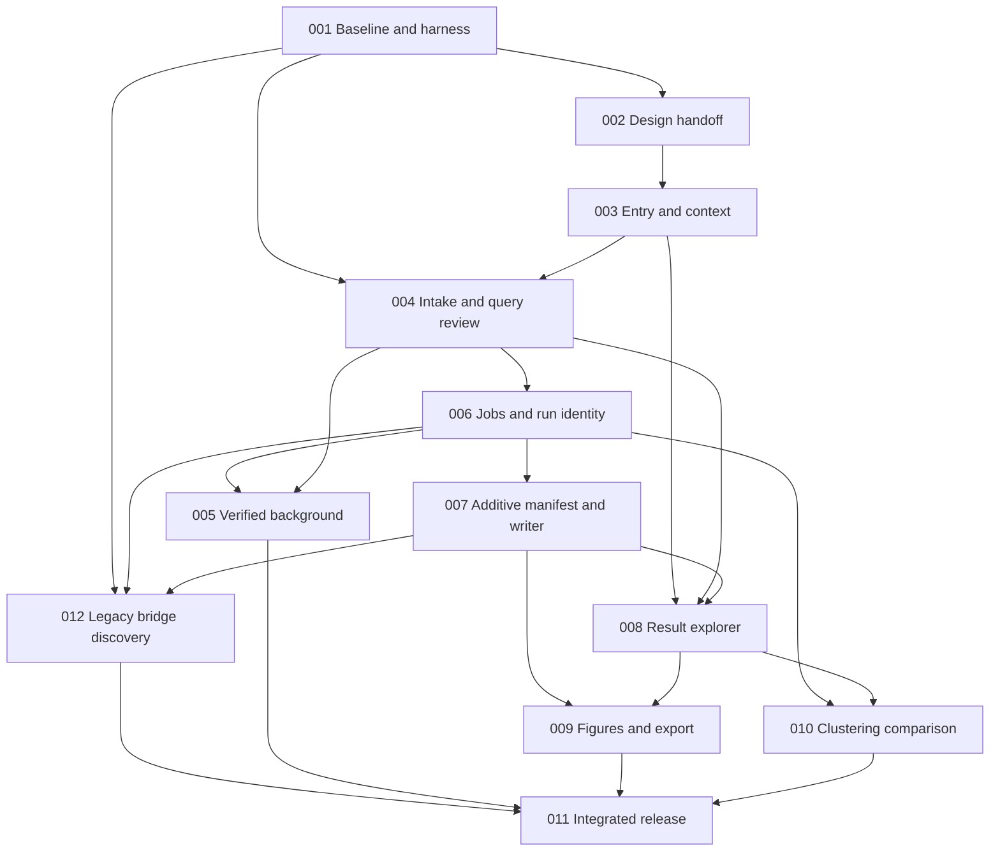

# Implementation plan — SPEC-WORKSPACE-001

This is a complete planning package, not an implementation report. All twelve leaves are **draft**, zero are resolved and the dispatch queue is **not activated**. The current worktree isolates planning from both the primary checkout and the deployed dependency worktree. The schema-required v0.1.7 target label is provisional next-unreleased metadata, not an agreed product version;011 decides the actual release number and package bump after scope is measured.

## Decisions to settle before expensive work

| Decision | Planned disposition | Evidence or validation still needed | Owner / gate |
|---|---|---|---|
| Overall interaction | Connected workspace on existing Shiny modules; no forced wizard | Annotated screens and unfamiliar-user tasks | UX/design, G1 |
| Navigation shell | First slice retains existing tab/input IDs, adds context and result cards; broader shell remains conditional | Prototype tasks show advantage without broken handoffs | UX, G1/G4 |
| Statistical meaning | Preserve original data and existing default threshold/engine semantics | Scientific fixture assertions on each route | QA/science, G0/G2 |
| Explicit background | Public richR0.1.5 universe API is the starting point; no new upstream release assumed | All enabled GO/KEGG/Reactome effective-universe/raw/adjusted oracles, invalid pair handling | Scientific reviewer, G2 |
| Metadata/model | Stable IDs, immutable inputs/results/run snapshots; display state separate | Schema review before 006/007 integration | Reviewer, G2 |
| Cancellation | Probe owned-worker termination; expose Stop only with acknowledgement | PID/resource ownership and stop tests, distinct unsupported fallback | QA/security, G2 |
| Legacy RDS compatibility |012 separate bounded discovery/bridge task; prefer proven browser confinement, tested local fallback only with explicit interaction acceptance | Target Linux capabilities, safe canaries, max two configurations/five probe cycles, complete nondeveloper restore; otherwise hold format rollout | Platform/security/product, G3L |
| Persistence | In-session job history and downloadable projects only | Interrupted saved job semantics; no worker handles stored | Reviewer, G3 |
| Missing values | Typed status plus original value; absent external rows remain unknown without test-family evidence | Import/result/figure roundtrip fixtures | Science/QA, G3/G4 |
| Resource controls |001 produces measured inst/config/workspace-resources.json and validated R loader before consumers | Bounded fixtures, measured memory/disk/admission/render limits, review and boundary tests;011 remeasures | QA/security, G0, refined G5 |
| Tooling gaps | Clean installed-package CI, optional separate provider smoke, policy snapshot | Runner/tool availability; LSP missing-tool disposition explicitly recorded | QA/orchestrator, G0 |
| Release | Coherent reviewed candidate, staged runtime and manual privileged deployment | Exact-commit gates and actual post-run worker evidence | Orchestrator, G5 |

The decision register describes planning defaults and unresolved evidence. It is not a decision-index artifact: canonical interview decision_gate is off. The accepted user scope already supplies authority to plan all improvements. New runtime behavior is not authorized by the existence of these drafts alone.

## Product slices and priorities

**High — Protect interpretation and compatibility.** Establish measured fixtures/CI, reviewed design states, honest query/background review, session-owned job lifecycle, transactional project metadata and a safe legacy migration gate.

**High — Deliver the first connected workspace.** Home entry actions, selected-analysis context, preserved handoffs, result cards and persistent job status. Keep all imported-only and unclustered routes. This slice can be reviewed independently before completing the broader explorer/comparison experience.

**Medium — Deepen exploration and output.** Linked term/cluster/gene selection, consistent dataset identity, comparison missing states, consistent figure controls and provenance-aware exports, clustering chooser and named immutable run comparison.

**High — Integrate and measure.** Observe unfamiliar-user tasks, verify keyboard/zoom/narrow screen, run exact scientific/security/runtime gates and prepare reversible release evidence.

An intermediate release may disable unverified custom background, Stop or new-format import to remain safe, but those leaves stay unresolved. The full program is complete only when all accepted capabilities pass or the user explicitly approves a revised scope. Safe hiding or a rollback switch is never counted as implementation of the hidden feature.

## Twelve implementation contracts

| SPEC | Deliverable | Logical prerequisites | Gate / main risk |
|---|---|---|---|
| [001](../SPEC-WS-001.md) | Actual baseline, resource policy/loader, complete policy transport, scientific fixtures and typed CLI browser harness | none | G0; missing gate assets or limits producer |
| [002](../SPEC-WS-002.md) | Tokens, accessible components and audited screen handoff |001| G1; cosmetic consistency without real states |
| [003](../SPEC-WS-003.md) | Actionable Home, active context, navigation adapters |002| G1/G4; broken IDs or forced sequence |
| [004](../SPEC-WS-004.md) | Intake validation and actual query review |001,003| G2; preview confused with analysis |
| [005](../SPEC-WS-005.md) | Explicit background through verified public APIs |004,006| G2; wrong denominator/correction family |
| [006](../SPEC-WS-006.md) | Persistent jobs, run records, cancellation and stale guards |004| G2; obsolete callback changes loaded workspace |
| [007](../SPEC-WS-007.md) | Additive manifest/project writer, safe JSON adapter and transactional legacy state application |006| G3; safe metadata must not wait for isolation discovery |
| [008](../SPEC-WS-008.md) | Result-first explorer and linked dataset selection |003,004,007| G4; wrong identity/missingness |
| [009](../SPEC-WS-009.md) | Consistent figures and settings/data exports |007,008| G4; display filter changes statistics |
| [010](../SPEC-WS-010.md) | Clustering chooser and named comparisons |006,008| G4; false cross-engine equivalence |
| [011](../SPEC-WS-011.md) | Integrated journeys, usability/accessibility/security and release |001..010,012| G5; unsupported completion claims |
| [012](../SPEC-WS-012.md) | Bounded legacy isolation discovery, bridge and representative migration |001,006,007| G3L; unproven confinement/usability |

Leaf technical sections identify concrete existing/new target files. `dispatch.json` is the exact machine-readable registry and must agree with those sections. `.github/workflows/workspace-quality.yml` and `playwright.config.ts` are created by 001 and modified by 011; their prerequisite-created classification does not imply they exist in the current baseline.

## File and logical dependency graph

011 also depends on all other nodes as listed in dispatch.json; the graph draws the principal chains for readability. Tests do not create unlisted permission to touch production code.

**File locks are conservative.** Every overlap in `target_files` serializes the writers even when their lines differ. Examples: `inst/application/app.R` in003/006/007/008/012; `R/enrich_tab.R` in004/005/006; `R/cluster_tab.R` in006/010; `R/save_tab.R` in007/009/012; `R/rr_visualize_tab.R` in004/008/009 and `R/clus_visualize_tab.R` in008/009; package metadata in001/005; workflow/config in001/011. Derive the complete overlap set mechanically from dispatch.json instead of trusting this illustrative list. NAMESPACE, lockfile and root configuration changes must be declared before dispatch whenever needed; internal helpers do not automatically require new public exports.

After006,005 and 007 can proceed together because their declared targets do not overlap. After007,008 and 012 have distinct logical eligibility, but app/save shared-file locks serialize their relevant writers;012 investigation may wait without holding locks. After008,009 and 010 can proceed together when actual slots permit.012 never becomes a logical prerequisite of008/009/010. This is dependency opportunity, not a promise of unbounded active agents. Upstream background research can collect read-only evidence earlier, but consumer implementation waits for its declared prerequisites.

## Hur Harness operating model

The orchestrator owns dispatch, evidence ledger, integration decisions, handoff/log and scope. Persistent reviewer, one QA owner and one security owner retain context; per-leaf implementers get fresh worktrees and self-contained briefs. On this harness, persistent roles may be idle while retaining context. Active concurrency is bounded by available slots (currently four total including orchestrator), permissions and the requirement for independent roles. Reserve review/QA/security execution capacity as needed; do not fill every slot with implementers or claim simultaneous roles that cannot run. Reviewer capacity scales with actual active implementers, not a predetermined team size.

Read-only plan/sync auditors run through the approved read-only launcher with `.moai/reports/` output, not write-capable agent spawning. Before launch, verify the required ignored .codex/agents/moai role profile is provisioned in the worktree, parse its TOML and confirm read-only sandbox. When absent, copy the canonical generated profile verbatim from the primary checkout with digest receipt; do not edit its body or run a broad template update to repair one missing file. A reviewer never approves their own implementation. A future manager-design owner supplies screen/design handoff; frontend implementation remains a separate implementer responsibility.

Continuous dispatch:

1. Read the current Git baseline, evidence ledger and registry; reject changed assumptions.
2. Compute nodes whose logical prerequisites have **approved and integrated** results; satisfied implementation alone does not unlock consumers.
3. Exclude nodes sharing a target with any active writer. Also reserve actual runtime slots and review capacity.
4. Dispatch every eligible node within those real constraints, in priority order; do not wait for an arbitrary batch.
5. Create a new worktree per leaf through supported lifecycle tooling. Self-contained prompt includes SPEC path, exact targets, stack, conventions, baseline, adapters, acceptance, relevant policy sources and evidence format.
6. On completion, independent reviewer checks diff and REQ/AC evidence immediately. Route confirmed gaps back to a clean implementer with specific failed evidence.
7. Retry reflection names what failed, the concrete correction and why it differs. After five failed attempts on one leaf, re-scope rather than repeating the same approach.
8. Integrate only approved work in an integration worktree; never switch/merge in the primary shared checkout. Re-read branch/HEAD before any commit/push, stage explicit paths and preserve foreign edits.
9. Recompute queue after each integration; run QA/security phase gates at the boundaries below, with additional security review on any new data-handling boundary.

## Milestone gates and evidence

| Gate | Required evidence | Blocks |
|---|---|---|
| G0 Baseline | Clean CI installed-package full suite/check; complete policy/rule closure; explicit TypeScript input set; scientific/browser fixtures; measured app resource configuration/loader and boundary tests | Runtime consumers lacking usable baseline/configuration |
| G1 Design/handoff | Reviewed token/components and annotated screen/state/handoff inventory; keyboard/focus/narrow-screen prototype checks | Screen code that guesses missing UX states |
| G2 Scientific/jobs | Query snapshot equality; all-route universe/raw/adjusted oracle; existing engine semantics; owner/generation race matrix; supported Stop proves owned process stopped | Scientific or lifecycle feature acceptance |
| G3 Additive data contract |007 typed manifest/writer and JSON roundtrip; every existing supported load uses validated atomic state application; failed imports preserve jobs; interrupted jobs not resumed |008/009 metadata consumers |
| G3L Legacy bridge |012 bounded discovery decision, proven confinement or explicitly accepted tested migration, complete representative restore task | Changed public format/legacy parser rollout and final release; never008/009 exploration |
| G4 Exploration | Stable linked identities, evidence-aware missing states, exact-value figures/exports, run comparison; keyboard/narrow-screen paths | Connected workspace release candidate |
| G5 Release | All leaf criteria plus clean full suite/check/coverage, CLI integrated journeys, manual accessibility, observed usability, security ledger, staging runtime and rollback receipt | Publication/deployment readiness |

**Executable policy transport:**001 owns scripts/export-workspace-policy.py and generated tracked docs/quality/workspace-policy-bundle.json. The exporter reads allowlisted canonical quality/harness/gate/security/LSP sources, records exact content/source paths/SHA256 digests, recursively includes all enabled referenced rule/config dependencies (including the ast-grep rule directories and sgconfig), and excludes unintended secret content before review. Missing referenced required assets fail export/preparation. Optional rule-self-test fixture references are classified explicitly; if self-tests are enabled their fixture closure becomes required. Hosted CI verifies/materializes that immutable reviewed bundle under canonical relative paths in an isolated policy root and invokes actual gate tools with explicit isolated-root rule/config resolution against the candidate code; it never assumes access to the primary computer. Regenerate/review on source-policy changes before candidate evaluation; record original and bundle digests in artifacts. Missing/invalid bundle or unsupported diagnostics/gate tooling blocks G0; there are no threshold defaults. The bundle is a generated snapshot, not an independently edited policy definition.

QA owns a single cumulative baseline ledger. The harness full-suite requirement is met in a clean gate runner, not by repeatedly saturating the shared workstation. A failed required test, unmeasured enabled scientific feature or unresolved Critical/High security finding blocks progression; do not waive it by adding a warning in the UI. Broader accessibility/usability failures are recorded with severity and blockers corrected before the affected route is declared ready. Evidence must include exact command/output, measured source/runtime, pass/fail/skip totals, policy version, retained artifacts and unobserved gaps.

## Bounded legacy discovery and independent rollout

012 is a deliberate twelfth atomic contract added after independent audit, replacing an underdefined discovery dependency inside007. It owns the platform investigator, concrete probe/converter artifacts and decision record. Candidate Linux bubblewrap isolation requires unprivileged user/mount/PID/IPC/UTS/network namespaces, allowlisted read-only runtime, empty credentials/home, constrained output and enforceable process/memory/CPU bounds. An already available equivalently restricted unprivileged container is the only second candidate; no infrastructure is assumed or installed during planning.

Read-only capability probes precede harmless disposable sentinel tests proving denied network/credential access/outside writes and enforced bounds/cleanup. Investigation is capped at two configurations and five total probe/revision cycles. The decision records proceed with proven browser bridge; explicitly accept a tested local migration with bench-user interaction cost; or hold/re-scope while legacy requirements stay open. A nondeveloper must restore an actual representative saved analysis, locate matching data/results/settings and reopen it without losing the original; no silently imposed shell/R-code task.

007 integrates additive metadata/writers and safe JSON independently and leaves the RDS parser/user entry compatible while applying all supported loads through common transactional validation and 006 generation guards.008/009 can proceed after 007 without waiting for012. The unchanged ordinary RDS parser retains an explicit unresolved risk;012 alone changes that trust boundary. A failed012 discovery never closes the bridge or full program, and 011 release/default-format rollout stays held until accepted or the user explicitly revises scope.

## Requirement-to-SPEC traceability

| Umbrella requirement | Primary implementation | Umbrella acceptance |
|---|---|---|
|001 Entry routes|003|AC-001|
|002 Context|003,006,007|AC-001,AC-006|
|003 Bypass/no wizard|003,008,011|AC-002|
|004 Scientific review|004,005|AC-003,AC-004|
|005 Preview vs persisted input|004,009|AC-003,AC-009|
|006 Background oracle|005|AC-004|
|007 Result-first/exact values|008,009|AC-005,AC-009|
|008 Linked identity/colors|008|AC-005|
|009 Missingness|007,008,009|AC-005,AC-008|
|010 Actual job status|006|AC-006|
|011 Stale callbacks|006,007|AC-006,AC-008|
|012 Owned cancellation|006|AC-007|
|013 Reproducible save|007,009|AC-008,AC-009|
|014 Legacy restoration|007,012,011|AC-008,AC-012|
|015 Import security|007,012,011|AC-008,AC-011|
|016 Figures|009|AC-009|
|017 Clustering semantics/comparison|010|AC-010|
|018 Accessibility|002,003,008,011|AC-011,AC-012|
|019 Verified release|001,011|AC-011,AC-012,AC-013|

## Risks, containment and rollback

- **Statistical drift:** freeze existing defaults and use independent tiny oracles; record changed statistical contracts explicitly. No private dependency patch. If an actual upstream gap emerges, a separately reviewed official release is an external prerequisite.
- **Legacy security versus bench-user continuity:** keep both interests explicit. A child process is not automatically a sandbox. Do not ship a format transition that loses legacy results or silently moves all users to an untested command-line process.
- **Asynchronous races:** invalidate generation before a successful state swap; failed imports do not invalidate the still-current workspace. Preserve guards during rollback until outstanding callbacks are inert.
- **Schema coupling:** freeze006 read-only run record and 007 manifest adapters before 008. Keep raw stores available behind adapters; avoid a simultaneous global rewrite.
- **Large results:** baseline and bound table/graph/archive sizes and worker admission; report limitations. No unbounded background contention.
- **Testing availability:** no current tracked CI/browser scaffold exists;001 supplies it. Tool absence is a gap. Configure the clean runner from actual project stack, not generic frontend defaults.
- **Rollbacks:** each leaf has its own rollback contract; keep original results and legacy files. A production rollback is app-scoped, preserves both releases and is user-executed under the established manual-sudo protocol. Never dispose of unintegrated worktrees.

## Work completion and communication

At planning close, report thirteen draft SPECs, twelve planned implementation nodes, zero implemented/resolved leaves, independent plan audit disposition and remaining product/security evidence decisions. At implementation close, report actual maximum concurrent implementers, spawns/reviews, measured test counts/security posture, migration support and exact release evidence. Log decisions and gate results as they occur, but do not fabricate historical measurements or require user approval between routine internal gates.

## Bounded001 G0 ownership amendment — audit pending

Actual candidate01 clean CI passed62 installed tests/408 assertions but failed required package check/examples and full coverage832/3900. Independent QA reproduced the undefined example and a correct-package library-alias counterexample; instrumentation calibration observed parent/worker hits. The actual candidate02 full outcome remains unknown at amendment preparation. The001 v0.1.1 contract therefore proposes exact documentation/generated-doc, equivalent duplicate-import, portable build metadata and meaningful existing-behavior test child targets with exclusive writer/read locks. This amendment requires independent plan-audit PASS before expanded execution; no runtime repair is authorized automatically.

The twelve whole-SPEC dependencies remain unchanged:001 is unresolved and002 cannot dispatch before its complete original G0 gate passes. B0 helper precedes dependent characterization writers; B1 generator output precedes native characterization; distinct test writers may run only within real slots and reviewed locks. Independent child reviews integrate to one candidate for required full suite/check/examples and canonical coverage, never partial001 approval. All six001 REQs/five ACs, thresholds, complete coverage denominator and future G5 requirements remain intact. See SPEC-WS-001.md and dispatch.json for exact targets.

The pre-audit revision expands001 to40 exact writer targets. B7 owns R/package.R/generated NAMESPACE to preserve the currently winning DT bindings while eliminating the two measured duplicate imports; B8 owns documentation-only R/rr_cluster.R plus two generated Rd files; B9 owns portable src/Makevars and the already-owned bounded DESCRIPTION metadata. B1/B7/B8 generators serialize; B3 waits for B7 and B6 waits for B1/B8/B9. The earlier master incoming-FALSE proposal was rejected by actual PREP and its raw evidence remains unchanged. The revised narrow profile retains master _R_CHECK_CRAN_INCOMING_=TRUE and sets only _R_CHECK_CRAN_INCOMING_REMOTE_=FALSE, preserving --no-manual/--as-cran, error_on=warning, canonical coverage/denominator and local code/doc/example/test/build checks; external repository publication eligibility and external URL/DOI/arXiv/ORCID/ROR liveness are explicitly excluded. No identical-documentation or CRAN-ready claim is allowed. Independent confirming plan review and root review precede any runner/default switch.

The bounded actual PREP experiment measured all14 intended outcomes under source/version anchored strict/narrow profiles: valid SUCCESS and six invalid intended rejections per profile (code/doc/example/test/build/no-exercises). Keep that experiment distinct from approved default operation/full package CI. Master TRUE retains the original direct no-exercises/S3/autoconf branches; retain the measured explicit strict flags, exact local/remote source inventory and paired result/section evidence. Incomplete controls or outcomes keep G0 held; no new research framework, weaker fallback or extra disabling variable is authorized. The frozen runner remains blocked until confirming approval.

B7 additionally owns only the verified public richR::ggnetwork, dplyr::distinct and plotly::plotlyOutput/renderPlotly import annotations/generated NAMESPACE. B3/B4 wait for its reviewed generator closure and actual installed direct UI/module/render before/after proof with preserved current DT bindings/formals/API. Controlled function-copy binding positives are investigative only and do not prove deployed runApp behavior. Private reverseList/my_net and scientific top-term/comma-input counterexamples stay retained for008/009, without expectation weakening or expected-error coverage tricks.

### Confirming D1-only URL companion and B9 dependency delta

The narrow remote-only profile also suppresses local URL findings inside a remote-guarded tools call. The existing runner therefore has a bounded companion reusing only fixed installed expressions4,9,10,12,13,14,15,18,23,24 with exact version/body/shape/mirror/formatter/enumerator/severity-wrapper guards; no network/header replay, checker fork or AST framework is permitted. Source URL enumeration records the actual candidate hash/From and all findings. Real local NOTEs remain original-severity visible, counted PASS_WITH_NOTES and nonblocking under unchanged error_on=warning; zero findings alone is CLEAN. Any unknown/guard/error holds PREP/G0, and WARNING/ERROR behavior is unchanged. Expected control findings are distinct from real-source acceptance.

Focused retained evidence contains10 source-db controls (4valid/6intended findings), frozen e2a8ac9f inventory5records/3unique/0findings, and a separate actual-input visible NOTE with findings1/PASS_WITH_NOTES. This is not a rerun of fourteen package checks or full CI; later composed source requires fresh enumeration. Prior rejected master-FALSE/source evidence stays unchanged. B9's existing DESCRIPTION target additionally covers direct withr test use verified by B5/F2 alongside later; no new writers/children/graph or runtime/scientific scope is introduced. Confirming plan audit/root review still precede default/source switch; G0 remains OPEN.
